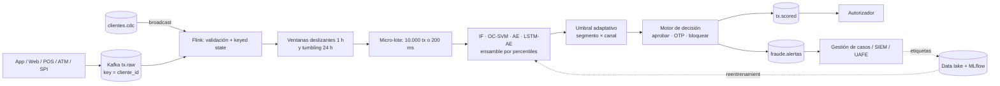

# Detección de anomalías en flujos de transacciones financieras – contexto ecuatoriano

**Maestría en Big Data y Ciencia de Datos – UNIANDES · Actividad sumativa 1 – Semana 2**
Autor: Luis Alberto De La Torre Durán

Implementación y evaluación de un sistema de detección de anomalías (Isolation Forest, LOF, Autoencoder, LSTM-Autoencoder y One-Class SVM) sobre un *dataset* sintético de transacciones de un banco ecuatoriano, con el diseño de un *pipeline* de *streaming* Kafka + Flink, explicabilidad con SHAP y vinculación con la normativa de la Superintendencia de Bancos y la LOPDP.

## Entregables

| # | Entregable | Ubicación |
|---|---|---|
| 1 | Cuaderno Jupyter documentado y ejecutado | `notebooks/deteccion_anomalias_fraude_ec.ipynb` |
| 2 | Informe técnico PDF (≥ 3.000 palabras, diagrama de arquitectura, conclusiones) | `informe/Informe_tecnico_deteccion_anomalias_DeLaTorre.pdf` |
| 3 | Referencias APA 7.ª edición (≥ 10 fuentes indexadas) | `REFERENCIAS.md` y al final del informe |

## Estructura

```
├── data/                  # dataset sintético generado por el cuaderno (csv.gz)
├── figures/               # figuras del EDA, resultados, latencia, SHAP y arquitectura
├── informe/               # informe técnico en PDF
├── notebooks/             # cuaderno principal
├── results/               # métricas (json/csv) consumidas por el informe
├── src/
│   ├── diagrama_arquitectura.py   # genera figures/11_arquitectura_streaming.png
│   └── generar_informe.py         # regenera el PDF a partir de results/
└── requirements.txt
```

## Reproducción

```bash
python -m venv .venv && source .venv/bin/activate
pip install -r requirements.txt
jupyter nbconvert --to notebook --execute --inplace notebooks/deteccion_anomalias_fraude_ec.ipynb
python src/diagrama_arquitectura.py
python src/generar_informe.py
```

Todo es determinista con `SEED = 42`, salvo los tiempos de latencia, que dependen del hardware (los reportados se midieron en un solo vCPU). Ejecución completa: ~6 min en CPU.

## Resultados principales (bloque de prueba, futuro no visto)

| Modelo | AUC-PR | F1 fraude | AUC-ROC | ms / lote 10k | Cumple 500 ms |
|---|---|---|---|---|---|
| Isolation Forest | 0,289 | 0,303 | 0,961 | 268 | ✅ |
| One-Class SVM (Nyström) | 0,270 | 0,302 | 0,937 | 57 | ✅ |
| Autoencoder denso | 0,195 | 0,252 | 0,931 | 74 | ✅ |
| LSTM-Autoencoder | 0,167 | 0,238 | 0,865 | 368 | ✅ |
| LOF | 0,405 | 0,415 | 0,936 | 1.872 | ❌ |
| **Ensamble (IF + OC-SVM + AE + LSTM-AE)** | **0,446** | **0,446** | 0,967 | 368 (paralelo) | ✅ |

Prevalencia de fraude en prueba: 0,66 % (línea base del AUC-PR).

## Arquitectura de streaming propuesta



## Aviso sobre los datos

El conjunto es 100 % sintético (Faker + NumPy). No contiene información de personas reales, por lo que su uso académico no implica tratamiento de datos personales en los términos de la LOPDP.
